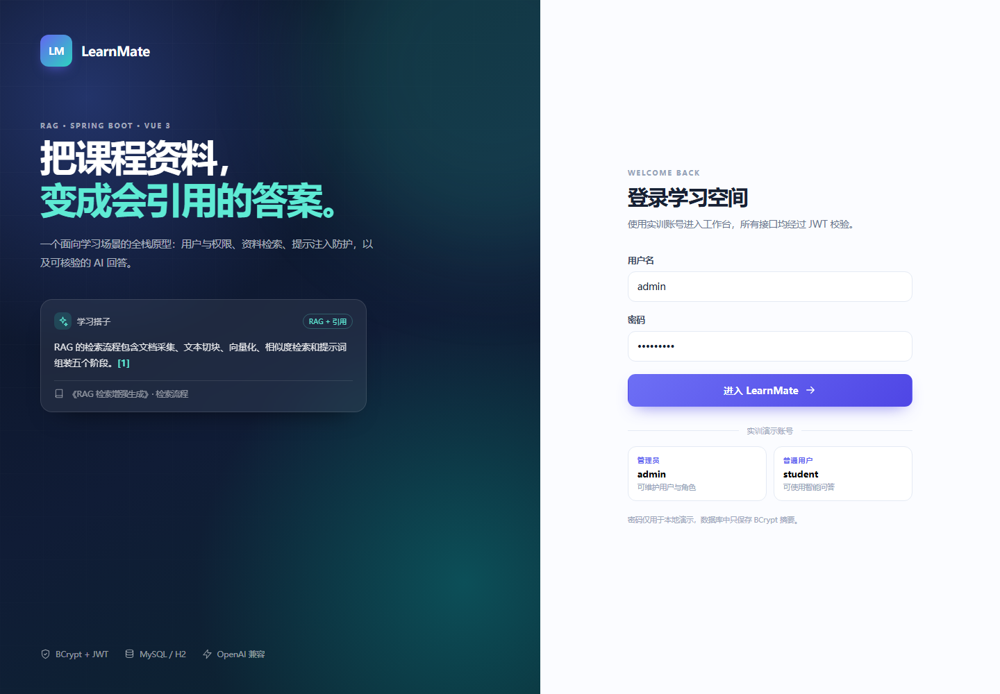

# LearnMate 学习搭子

这是《团队规范实训》的课程项目。后端用 Spring Boot + MyBatis，前端用 Vue 3，功能包括用户管理、JWT 登录、角色权限和课程资料问答。



## 功能

- 用户表 CRUD，用户名唯一，密码用 BCrypt 保存
- JWT 登录，ADMIN / USER 两种角色
- Vue 3 页面：登录、总览、用户管理、智能问答
- 课程资料切块、检索、带来源的问答

## 环境

需要 JDK 17+、Maven 3.9+、Node.js 20+。MySQL 8 和 Docker 是可选的，默认用 H2 就能运行。

具体安装和配置见 [SETUP.md](SETUP.md)。

## 运行

### 1. 默认 H2（不需要 MySQL）

```powershell
cd backend
mvn spring-boot:run
```

打开 <http://127.0.0.1:8080>，接口文档在 <http://127.0.0.1:8080/swagger-ui.html>。

H2 是内存库，重启后数据会重置。

### 2. MySQL 8

```powershell
docker compose up -d
cd backend
mvn spring-boot:run -Dspring-boot.run.profiles=mysql
```

Docker 里的数据库、账号和密码在 `docker-compose.yml` 中。也可以用自己的 MySQL，建库后通过 `DB_URL`、`DB_USER`、`DB_PASSWORD` 连接。具体步骤见 [SETUP.md](SETUP.md)。

### 3. 前端开发

```powershell
cd frontend
npm install
npm run dev
```

打开 <http://127.0.0.1:5173>，Vite 会把 `/api` 代理到 8080。

### 4. 打包

```powershell
cd frontend
npm run build
```

把 `dist/` 复制到 `backend/src/main/resources/static/`，再执行：

```powershell
cd ../backend
mvn clean package
java -jar target/learnmate.jar
```

也可以直接运行 `scripts/build-all.ps1`。

## 账号

| 用户名 | 密码 | 角色 |
|---|---|---|
| `admin` | `Admin@123` | ADMIN |
| `student` | `Student@123` | USER |

这两个账号只用于本地演示，部署前请修改。

## 接口

| 方法 | 路径 | 说明 |
|---|---|---|
| POST | `/api/auth/login` | 登录，返回 JWT |
| GET | `/api/auth/me` | 当前用户 |
| GET | `/api/users` | 用户列表（ADMIN） |
| POST | `/api/users` | 新增用户（ADMIN） |
| PUT | `/api/users/{id}` | 修改用户（ADMIN） |
| DELETE | `/api/users/{id}` | 删除用户（ADMIN） |
| GET | `/api/dashboard/stats` | 首页统计 |
| POST | `/api/ai/chat` | 课程资料问答 |
| GET | `/api/ai/search?q=` | 只检索，不生成 |
| GET | `/api/ai/health` | 模型和知识库状态 |

返回格式：

```json
{ "code": 0, "message": "OK", "data": {} }
```

## 目录

```text
backend/        Spring Boot 后端
frontend/       Vue 3 前端
sql/            MySQL 初始化脚本
docs/           截图、证据和实验报告
scripts/        构建、冒烟测试、报告生成脚本
```

后端主要代码：

- `user/`：用户 CRUD
- `auth/`：登录、JWT、Security
- `ai/`：LLM 客户端、RAG、提示注入防护
- `config/`：数据源、Security、Swagger、初始化数据

## 测试

```powershell
cd backend
mvn test
```

共 16 个测试，使用 H2 内存库，不需要启动 MySQL。

## 大模型配置

不配置 Key 时使用本地检索，返回资料摘录和来源。需要接模型时设置：

```powershell
$env:LLM_ENABLED="true"
$env:LLM_BASE_URL="https://api.deepseek.com"
$env:LLM_API_KEY="你的Key"
$env:LLM_MODEL="deepseek-chat"
```

Key 只放在环境变量里，不要写进代码或提交到 Git。

## 实验报告

- [最终合并报告 DOCX](docs/reports/202432110215李耀.docx)
- [最终合并报告 PDF](docs/reports/202432110215李耀.pdf)
